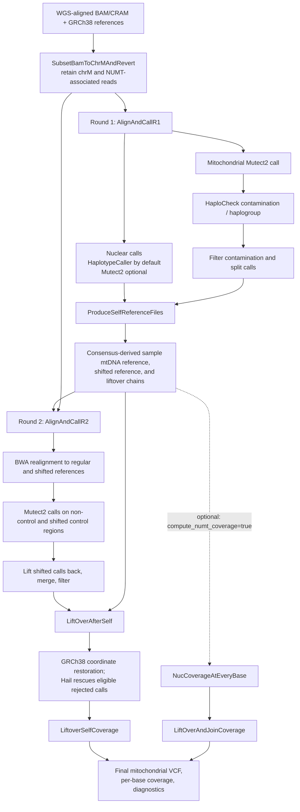

# mtSwirl WDL pipeline

[](https://zenodo.org/badge/latestdoi/448948131)

mtSwirl is a reference-aware pipeline for analyzing mitochondrial DNA (mtDNA)
copy number and heteroplasmy from whole-genome sequencing (WGS) data. The WDL
workflow sources are in [`inputs/wdl/`](inputs/wdl/); helper scripts and
reference resources are under [`resources/`](resources/).

This repository currently provides:

- **Single-sample v2.5:** Cromwell workflow for processing one WGS CRAM/BAM
  and producing mitochondrial calls and QC outputs.
- **Multi-sample v2.6:** serial and parallel WDL workflows for batched
  multi-sample processing. Local copies are kept in the Git-ignored
  `archive/` directory; they are not included in a fresh checkout.

The active single-sample WDL runs tools from the host environment rather than
Docker task images. It uses WDL/Cromwell to orchestrate the analysis, with
Conda environments providing the required bioinformatics and scripting tools.
The local multi-sample v2.6 WDLs in `archive/`, when present, are separate
legacy workflows and may still expect their original container setup.

## Repository layout

```text
inputs/
├── config/                       # Local Cromwell configuration
├── json/                         # Active offline single-sample input
├── wdl/                          # Active v2.5 single-sample WDL sources
└── wgs/                          # Local sample inputs (for testing)
resources/
├── cromwell/                     # Cromwell and Womtool JARs
├── docker/                       # Legacy saved Docker image archives
├── files/                        # chrM and NUMT resources
├── grch38/                       # GRCh38 reference files
└── scripts/                      # Pipeline helper and download scripts
archive/                           # Local-only archived WDLs and input templates
cromwell-executions/              # Execution workspaces and intermediates
cromwell-workflow-logs/           # Cromwell workflow logs
tests/cromwell-outputs/            # Curated final output copies
```

## Single-sample pipeline schematic

The active entry point is `MitochondriaPipeline` in
`inputs/wdl/MitoPipeline.wdl`. It starts with a WGS-aligned BAM/CRAM, calls
variants against the original reference, builds a sample-specific mitochondrial
reference from high-confidence homoplasmies, then realigns and calls variants
again against that reference. The final calls and coverage are returned to
GRCh38 coordinates. The two calling rounds help reduce reference-allele bias;
the second alignment also handles the circular mitochondrial control region by
calling it in a shifted coordinate system.



### What each WDL task does

The following names are the task identifiers in `inputs/wdl/MongoTasks.wdl`;
the round and reference-generation workflows call them in the order shown
above. Some tasks are conditional or are alternatives.

| Stage | Task | Purpose |
|---|---|---|
| Input preparation | `MongoSubsetBamToChrMAndRevert` | Select reads overlapping chrM and supplied nuclear mitochondrial insertion (NUMT) intervals; prepare the subset BAM and an unmapped-read BAM for later realignment. Also records alignment and coverage QC. |
| Round 1, nuclear | `MongoHC` | Calls nuclear variants with GATK HaplotypeCaller (the default path) and produces filtered and split VCFs. |
| Round 1, nuclear alternative | `MongoNucM2` | Alternative nuclear Mutect2 calling/filtering path when HaplotypeCaller is disabled. |
| Round 1, mitochondria | `MongoRunM2InitialFilterSplit` | Runs mitochondrial Mutect2 and initial filtering/statistics; provides calls for contamination estimation. |
| Round 1, QC | `GetContamination` | Runs the local HaploCheck CLI on mitochondrial calls to estimate contamination and report major/minor haplogroups. |
| Round 1, filtering | `MongoM2FilterContaminationSplit` | Applies contamination-aware mitochondrial filtering and emits split calls used downstream. |
| Personalized reference | `MongoProduceSelfReference` | Applies selected homoplasmies to create sample-specific mitochondrial FASTA references (regular and shifted), indexes/dictionaries, liftover chains, and downstream calls/intervals. Checks overlapping or out-of-interval variants. |
| Personalized reference | `MongoChainSwapLiftoverBed` | Reverses the reference-to-self chain as needed and lifts blacklist BED annotations into sample-reference coordinates. |
| Personalized reference, optional | `CreateSpanIntervalsWithDict` | Rebuilds nuclear interval lists to span contigs in the personalized-reference dictionary; used for NUMT coverage. |
| Personalized reference, optional | `ChainSwap` | Reverses a chain file for the nuclear self-reference liftover direction; used for NUMT coverage. |
| Personalized reference, optional | `MoveChainToZero` | Adjusts nuclear chain coordinates to the zero-based contigs produced from interval subsets; used for NUMT coverage. |
| Round 2, alignment/QC | `MongoAlignToMtRegShiftedAndMetrics` | Converts subset reads to FASTQ, aligns separately with BWA to regular and shifted references, merges/sorts with GATK, marks duplicates, and collects alignment/coverage metrics. |
| Round 2, calling | `MongoCallMtAndShifted` | Calls the non-control region against the regular reference and the control region against the shifted reference, using round-1 homoplasmies as force-call sites. |
| Round 2, filtering | `MongoLiftoverCombineMergeFilterContamSplit` | Returns shifted control-region calls to regular self-reference coordinates, combines the calls, applies filtering, and produces split VCFs. |
| Final calls/coverage | `MongoLiftoverVCFAndGetCoverage` | Lifts second-round calls back to GRCh38; uses Hail to rescue eligible liftover rejects, merges rescued and successful calls, and calculates per-base mitochondrial coverage. |
| Final calls/coverage | `MongoLiftoverSelfAndCollectOutputs` | Lifts coverage back to reference coordinates, accounts for homoplasmic deletion coverage, and assembles the diagnostic statistics table. |
| NUMT coverage, optional | `NucCoverageAtEveryBase` | Measures per-base nuclear/NUMT interval coverage before and after realignment to regular and shifted personalized references. |
| NUMT coverage, optional | `LiftOverAndJoinCoverage` | Maps personalized-reference coverage back to the original intervals and joins the tables for comparison. |

`ScatterPipeline.wdl` provides a multi-sample wrapper around the per-sample
workflow. Its `MergeMitoMultiSampleOutputsInternal` task combines per-sample
statistics, coverage, and variant calls into batch-level outputs.

## Run the single-sample test

The supplied offline inputs describe the NA18484 test sample. Paths in the
JSON are repository-root relative, so run validation and Cromwell from the
repository root.

### Requirements

Prepare or download inputs with internet access. The active single-sample
workflow runs locally without Docker; it needs Cromwell/Womtool, Java, the
bioinformatics tools, and the Conda environments listed below.

- Java 17 for Cromwell and GATK
- `curl`, `gzip`, and `md5sum`
- Google Cloud CLI (`gcloud`) to download Broad public reference files
- Substantial disk space for WGS data, references, and task intermediates

On Ubuntu or Debian, install the system utilities with:

```bash
sudo apt-get update
sudo apt-get install -y openjdk-17-jre curl gzip coreutils
```

Install the [Google Cloud CLI](https://cloud.google.com/sdk/docs/install) if
you need to download the GRCh38 reference. The mitochondrial reference files
and supporting resources under `resources/files/` are distributed with this
package and do not need to be downloaded separately. Cromwell 92 and Womtool
92 are described below.

### Prepare inputs

The offline test JSON is `inputs/json/prepopulated_inputs_offline_single.json`.
It points to the local CRAM in `inputs/wgs/NA18484/`, GRCh38 and mitochondrial
references in `resources/`, and helper scripts in `resources/scripts/`.

Download the NA18484 CRAM and index from 1000 Genomes:

```bash
mkdir -p inputs/wgs/NA18484
cd inputs/wgs/NA18484

curl -fL --retry 5 -o NA18484.final.cram \
  'https://ftp.sra.ebi.ac.uk/vol1/run/ERR398/ERR3989343/NA18484.final.cram'
curl -fL --retry 5 -o NA18484.final.cram.crai \
  'https://ftp.sra.ebi.ac.uk/vol1/run/ERR398/ERR3989343/NA18484.final.cram.crai'

printf '%s  %s\n' \
  'e3699af246f2d14499f7ac8bd96d7ab4' NA18484.final.cram \
  'd4186393767fb0d251da9e23d07c35cc' NA18484.final.cram.crai \
  | md5sum --check
cd -
```

Place the GRCh38 FASTA, FAI, and dictionary in `resources/grch38/`. If you
need to download them, the Broad helper fetches the files from the public
reference bucket:

```bash
mkdir -p resources/grch38
cd resources/grch38
bash ../scripts/get_hg38_from_gcp.sh
cd -
```

The mitochondrial FASTA files, indices, interval lists, blacklist, and
liftover resources are already provided under `resources/files/` when using
the packaged distribution. No separate mitochondrial-reference download is
needed.

### Prepare tools

The active single-sample workflow expects host tools to be available on
`PATH`. The local setup used for this WDL has:

- `mtSwirl`: Java 17, GATK, BWA, samtools, bcftools, bgzip/tabix, bedtools,
  and the UCSC/IGV utilities used by liftover tasks.
- `hail`: Python with Hail and pandas; Hail/Spark tasks use this environment's
  Java 11.
- `R`: `R`, `Rscript`, and the `data.table` package.
- `resources/scripts/haplocheckCLI.jar`: the HaploCheck CLI supplied to the
  workflow as a file input.

`run_single_sample.sh` prepends these Conda `bin` directories to `PATH` and
exports the Hail variables used by the WDL. By default it looks for the
environments at `$HOME/miniconda3/envs/mtSwirl`, `$HOME/miniconda3/envs/hail`,
and `$HOME/miniconda3/envs/R`; set `MTSWIRL_CONDA_PREFIX`,
`HAIL_CONDA_PREFIX`, or `R_CONDA_PREFIX` to override those locations.

Download Cromwell and Womtool version 92 to `resources/cromwell/`:

```bash
mkdir -p resources/cromwell
curl -fL \
  https://github.com/broadinstitute/cromwell/releases/download/92/cromwell-92.jar \
  -o resources/cromwell/cromwell-92.jar
curl -fL \
  https://github.com/broadinstitute/cromwell/releases/download/92/womtool-92.jar \
  -o resources/cromwell/womtool-92.jar
```

### Validate and run

Validate the workflow and input JSON before running Cromwell:
```bash
java -jar resources/cromwell/womtool-92.jar validate \
  -i inputs/json/prepopulated_inputs_offline_single.json \
  -l inputs/wdl/MitoPipeline.wdl
```

Run the local workflow:
```bash
bash resources/scripts/run_single_sample.sh
```

The config at `inputs/config/cromwell-local-single.conf` limits execution to
one task at a time. Cromwell writes execution directories to
`cromwell-executions/` and logs to `cromwell-workflow-logs/`; after success,
the run helper copies curated outputs to `tests/cromwell-outputs/`.
The run helper waits for Cromwell to finish successfully, reads the workflow
ID from Cromwell's metadata, and automatically copies the final VCF and
diagnostic TSV into the curated output directory.

This local Cromwell backend does not enforce cloud-style WDL resource requests,
so a successful local test validates workflow execution but does not establish
HPC scheduler resource requirements.

## Multi-sample workflows and DNAnexus

The repository's multi-sample v2.6 WDLs and their example DNAnexus input
templates have been moved under `archive/` and are ignored by Git. They are
available only in working copies where those files are present; they will not
be included in a fresh clone. The local archived entry workflows are:

- Serial: `archive/wdl/fullMitoPipeline_v2_6_Multi.wdl`
- Parallel: `archive/wdl/parallel_fullMitoPipeline_v2_6_Multi.wdl`

If you have those files locally and use DNAnexus, compile from the repository
root with dxCompiler:

```bash
bash archive/scripts/run-dxcompiler-docker-multi compile \
  archive/wdl/fullMitoPipeline_v2_6_Multi.wdl \
  -project PROJECT_ID -folder DESIRED_DX_PATH -f
```

For the parallel workflow:

```bash
bash archive/scripts/run-dxcompiler-docker-multi compile \
  archive/wdl/parallel_fullMitoPipeline_v2_6_Multi.wdl \
  -project PROJECT_ID -folder DESIRED_DX_PATH -f
```

The archived input templates are `archive/json/prepopulated_inputs_dx.json`
and `archive/json/prepopulated_inputs_dx_parallel.json`. They are examples
only: replace Docker image placeholders, update file locations to DNAnexus
links, and supply three per-run arrays with matching order and length:

- `stage-common.sample_name`: sample names.
- `stage-common.wgs_aligned_input_bam_or_cram`: WGS CRAM/BAM links.
- `stage-common.wgs_aligned_input_bam_or_cram_index`: matching CRAI/BAI links.

The parallel template shows the higher CPU and batch-size settings expected
for the parallel workflow. The WDL documentation recommends batching up to
18 samples for the serial full pipeline or 40 for the parallel workflow,
subject to available instance resources.

### Legacy multi-sample image inputs

The archived multi-sample WDLs may refer to these image inputs:

- `ucsc_docker`: `rahulg603/ucsc_docker`
- `genomes_cloud_docker`: `rahulg603/genomes_cloud_docker`
- `haplochecker_docker`: `rahulg603/haplochecker_docker`
- `gatk_samtools_docker`: `rahulg603/gatk_samtools_docker`

These archived workflows are not used by the active single-sample local run.

## Outputs and cleanup

Cromwell assigns a unique workflow ID to each run. Execution data and
intermediates are retained beneath
`cromwell-executions/MitochondriaPipeline/<workflow-id>/`.

The primary outputs are the final mitochondrial VCF and diagnostic statistics
TSV. The run helper copies them to
`tests/cromwell-outputs/MitochondriaPipeline/<workflow-id>/NA18484/`, leaves
the originals in the execution tree, and refuses to overwrite an existing
destination. The copy can also be run manually with
`resources/scripts/copy_single_sample_outputs.sh <workflow-id> <sample-name>`.
Workflow logs are under `cromwell-workflow-logs/`.

Execution directories can be large. Only remove a run's execution directory
after confirming the workflow succeeded and keeping any intermediates or
outputs you need. Curated output copies are separate and are not removed with
the execution directory.

## Project checklist

### Completed

- [x] Keep the test sample, references, Cromwell, and Womtool organized in the
  repository's `inputs/` and `resources/` directories.
- [x] Configure the local Cromwell run and validate the single-sample WDL and
  input JSON with Womtool.
- [x] Add a run helper that automatically copies the final VCF and diagnostic
  TSV to a sample-specific output directory after a successful run.
- [x] Replace active single-sample Docker task execution with host tools and
  local Conda environments.

### Migration plan

- [ ] Run the current v2.5 single-sample workflow successfully and preserve
  its outputs and logs as a reproducible baseline.
- [ ] Consolidate R and shell helper logic into Python scripts, porting one
  operation at a time and comparing outputs against the baseline.
- [ ] Add focused tests for the Python helpers, including representative
  edge cases from the existing workflow.
- [ ] Harmonize WDL memory assignments across tasks: use consistent task
  runtime memory and Java heap conventions, and verify that Java heap limits
  leave sufficient headroom within each task's total memory allocation.
- [ ] Run the complete workflow on the target HPC system and compare final
  and relevant intermediate outputs against the baseline.
- [ ] Measure actual CPU, memory, disk, and runtime requirements on the
  target HPC environment; the local Cromwell backend does not validate
  scheduler resource requests.
- [ ] Develop and validate the separate cross-sample merging workflow.

Keep WDL orchestration while comparing outputs and porting helper scripts.
Separating scientific-logic changes from execution-environment changes makes
regressions easier to locate. A Python package or command-line interface can
be introduced around the Python helpers as the interface and configuration
stabilize; a complete rewrite of the workflow runner is not required.

## Additional project context

The original mtSwirl project developed reference-aware quantification of
mtDNA copy number and heteroplasmy using WGS. The repository includes
single-sample and multi-sample WDL sources; the test instructions above focus
on validating and running the single-sample workflow.

For work using the pipeline, cite the associated paper:

> Gupta, R., Kanai, M., Durham, T.J. et al. Nuclear genetic control of mtDNA
> copy number and heteroplasmy in humans. *Nature* (2023).
> https://doi.org/10.1038/s41586-023-06426-5
