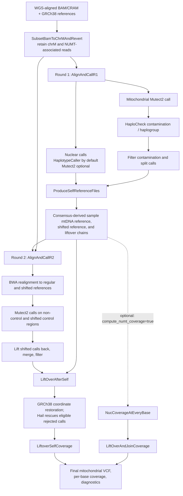

# mtSwirl WDL pipeline

[](https://zenodo.org/badge/latestdoi/448948131)


The original mtSwirl project developed reference-aware quantification of mtDNA
copy number and heteroplasmy from whole-genome sequencing (WGS) data. The
source repository includes single-sample and multi-sample WDL workflows.

For work using the pipeline, cite the associated paper:

> Gupta, R., Kanai, M., Durham, T.J. et al. Nuclear genetic control of mtDNA
> copy number and heteroplasmy in humans. *Nature* (2023).
> https://doi.org/10.1038/s41586-023-06426-5


The original source includes two main workflow versions:
- **Single-sample v2.5:** WDL workflow for processing one WGS CRAM/BAM
  and producing mitochondrial calls and QC outputs.
- **Multi-sample v2.6:** serial and parallel WDL workflows for batched
  multi-sample processing (e.g., UKB and AoU).

The original workflows rely on several Docker images (up to five, depending on
the workflow).

## This repository

This repository currently provides a host-based adaptation of the original
single-sample v2.5 workflow. Cromwell orchestrates the WDL tasks, while the
bioinformatics and scripting tools are supplied by local Conda environments
or HPC modules. The active workflow does not run in a consolidated container;
container packaging remains planned work.


## Repository layout

```text
inputs/
├── config/                       # Local Cromwell configuration
├── json/                         # Active offline single-sample input
├── wdl/                          # Active v2.5 single-sample WDL sources
└── wgs/                          # Local sample inputs (for testing)
resources/
├── cromwell/                     # Cromwell and Womtool JARs
├── docker/                       # Legacy saved Docker image archives
├── files/                        # chrM and NUMT resources
├── grch38/                       # GRCh38 reference files
└── scripts/                      # Pipeline helper and download scripts
archive/                           # Local-only archived WDLs and input templates
cromwell-executions/              # Execution workspaces and intermediates (ignored)
cromwell-workflow-logs/           # Cromwell workflow logs (ignored)
cromwell-outputs/                  # Curated outputs copied after successful runs
```

## Single-sample pipeline schematic

The active entry point is `MitochondriaPipeline` in
`inputs/wdl/MitoPipeline.wdl`. It starts with a WGS-aligned BAM/CRAM, calls
variants against the original reference, builds a sample-specific mitochondrial
reference from high-confidence homoplasmies, then realigns and calls variants
again against that reference. The final calls and coverage are returned to
GRCh38 coordinates. The two calling rounds help reduce reference-allele bias;
the second alignment also handles the circular mitochondrial control region by
calling it in a shifted coordinate system.



### What each WDL task does

The following names are the task identifiers in `inputs/wdl/MongoTasks.wdl`;
the round and reference-generation workflows call them in the order shown
above. Some tasks are conditional or are alternatives.

| Stage | Task | Purpose |
|---|---|---|
| Input preparation | `MongoSubsetBamToChrMAndRevert` | Select reads overlapping chrM and supplied nuclear mitochondrial insertion (NUMT) intervals; prepare the subset BAM and an unmapped-read BAM for later realignment. Also records alignment and coverage QC. |
| Round 1, nuclear | `MongoHC` | Calls nuclear variants with GATK HaplotypeCaller (the default path) and produces filtered and split VCFs. |
| Round 1, nuclear alternative | `MongoNucM2` | Alternative nuclear Mutect2 calling/filtering path when HaplotypeCaller is disabled. |
| Round 1, mitochondria | `MongoRunM2InitialFilterSplit` | Runs mitochondrial Mutect2 and initial filtering/statistics; provides calls for contamination estimation. |
| Round 1, QC | `GetContamination` | Runs the local HaploCheck CLI on mitochondrial calls to estimate contamination and report major/minor haplogroups. |
| Round 1, filtering | `MongoM2FilterContaminationSplit` | Applies contamination-aware mitochondrial filtering and emits split calls used downstream. |
| Personalized reference | `MongoProduceSelfReference` | Applies selected homoplasmies to create sample-specific mitochondrial FASTA references (regular and shifted), indexes/dictionaries, liftover chains, and downstream calls/intervals. Checks overlapping or out-of-interval variants. |
| Personalized reference | `MongoChainSwapLiftoverBed` | Reverses the reference-to-self chain as needed and lifts blacklist BED annotations into sample-reference coordinates. |
| Personalized reference, optional | `CreateSpanIntervalsWithDict` | Rebuilds nuclear interval lists to span contigs in the personalized-reference dictionary; used for NUMT coverage. |
| Personalized reference, optional | `ChainSwap` | Reverses a chain file for the nuclear self-reference liftover direction; used for NUMT coverage. |
| Personalized reference, optional | `MoveChainToZero` | Adjusts nuclear chain coordinates to the zero-based contigs produced from interval subsets; used for NUMT coverage. |
| Round 2, alignment/QC | `MongoAlignToMtRegShiftedAndMetrics` | Converts subset reads to FASTQ, aligns separately with BWA to regular and shifted references, merges/sorts with GATK, marks duplicates, and collects alignment/coverage metrics. |
| Round 2, calling | `MongoCallMtAndShifted` | Calls the non-control region against the regular reference and the control region against the shifted reference, using round-1 homoplasmies as force-call sites. |
| Round 2, filtering | `MongoLiftoverCombineMergeFilterContamSplit` | Returns shifted control-region calls to regular self-reference coordinates, combines the calls, applies filtering, and produces split VCFs. |
| Final calls/coverage | `MongoLiftoverVCFAndGetCoverage` | Lifts second-round calls back to GRCh38; uses Hail to rescue eligible liftover rejects, merges rescued and successful calls, and calculates per-base mitochondrial coverage. |
| Final calls/coverage | `MongoLiftoverSelfAndCollectOutputs` | Lifts coverage back to reference coordinates, accounts for homoplasmic deletion coverage, and assembles the diagnostic statistics table. |
| NUMT coverage, optional | `NucCoverageAtEveryBase` | Measures per-base nuclear/NUMT interval coverage before and after realignment to regular and shifted personalized references. |
| NUMT coverage, optional | `LiftOverAndJoinCoverage` | Maps personalized-reference coverage back to the original intervals and joins the tables for comparison. |

`ScatterPipeline.wdl` provides a multi-sample wrapper around the per-sample
workflow. Its `MergeMitoMultiSampleOutputsInternal` task combines per-sample
statistics, coverage, and variant calls into batch-level outputs.

## Requirements

To run the single-sample workflow locally without Docker or Apptainer, prepare
the input data and reference files, then make the required tools available on
`PATH` (for example, using Conda environments or HPC modules). Preparing the
inputs may require internet access or transferring files from an environment
with data access.

Required tools and data include:

- The GRCh38 reference FASTA, index, and sequence dictionary.
- A WGS CRAM/BAM and its matching index. The supplied test JSON uses a small,
  chrM-only fixture; use a full WGS file for representative NUMT read selection.
- Cromwell and Womtool (tested with v92), GATK (tested with 4.7), and Java 17.
- BWA, bedtools, HTSlib (`samtools`, `bcftools`, `bgzip`, and `tabix`), and
  `igvtools`.
- Hail with Python 3.11; Java 11 is recommended for the current Hail release.
- R, `Rscript`, and the `data.table` package (tested with R 4.5.3).
- Sufficient disk space for references, input data, and workflow intermediates.

Conda is recommended for installing and isolating dependencies. `curl` or
`wget`, `gzip`, `md5sum`, and Google Cloud CLI (`gcloud`) are useful for
downloading and checking inputs and reference files.

## Testing

The supplied offline input JSON configures a single-sample test for NA18484
using a small chrM-only CRAM fixture. Run the entry workflow
`inputs/wdl/MitoPipeline.wdl` with Cromwell and the input JSON at
`inputs/json/inputs_NA18484_chrM.json`.

The JSON references the GRCh38 files in `resources/grch38/`, mitochondrial
and NUMT resources in `resources/files/`, helper scripts in `resources/scripts/`,
and the test CRAM in `inputs/wgs/NA18484/`.

The entry workflow imports task definitions and sub-workflows from the other
WDL files under `inputs/wdl/`. The Cromwell configuration is in
`inputs/config/`. Validate with Womtool before running Cromwell. Input paths
are relative to the repository root, so run both commands from that directory.
Execution workspaces are written under `cromwell-executions/`; runtime and
storage requirements vary with the input data and host.


More details on how to prepare the resources and tools are provided below.

### Prepare input WGS BAM/CRAM

The supplied test JSON points to `inputs/wgs/NA18484/NA18484.chrM.cram`.
That small fixture contains chrM reads only. To use the full public WGS CRAM
instead (which allows the workflow to select reads from nuclear NUMT
intervals as well), download the CRAM and index from 1000 Genomes and update
the two CRAM input paths in the JSON to match the downloaded filenames:

```bash
mkdir -p inputs/wgs/NA18484
cd inputs/wgs/NA18484

curl -fL --retry 5 -o NA18484.final.cram \
  'https://ftp.sra.ebi.ac.uk/vol1/run/ERR398/ERR3989343/NA18484.final.cram'
curl -fL --retry 5 -o NA18484.final.cram.crai \
  'https://ftp.sra.ebi.ac.uk/vol1/run/ERR398/ERR3989343/NA18484.final.cram.crai'
```

To check integrity:

```bash
printf '%s  %s\n' \
  'e3699af246f2d14499f7ac8bd96d7ab4' NA18484.final.cram \
  'd4186393767fb0d251da9e23d07c35cc' NA18484.final.cram.crai \
  | md5sum --check
cd -
```

The download commands above provide the full WGS CRAM; they do not recreate
the smaller chrM-only fixture.

Set `MitochondriaPipeline.sample_name` in the input JSON to the sample name
recorded in the CRAM's read-group `SM` field. The workflow uses this value to
select the sample's alleles when constructing consensus references. Check the
CRAM header with `samtools view -H <file.cram> | grep '^@RG'` and use the
corresponding `SM:` value; for both NA18484 CRAMs, that value is `NA18484`.

### Prepare the reference genome

The mitochondrial FASTA files, indices, interval lists, blacklist, and
liftover resources are provided under `resources/files/`. No separate
mitochondrial-reference download is needed unless working with a different
reference other than GRCh38.

Place the GRCh38 FASTA, FAI, and dictionary in `resources/grch38/`. If you
need to download them, the provided helper uses `gcloud` (from `PATH`) to fetch the files
from the public reference bucket:

```bash
mkdir -p resources/grch38
cd resources/grch38
bash ../scripts/get_hg38_from_gcp.sh
cd -
```


### Prepare required tools and environment

The active single-sample workflow expects host tools on `PATH`. Use separate
environments so Cromwell/GATK can use Java 17 while the current Hail release
uses its supported Java 11 runtime.

Create the tools environment with Python 3.12, Java 17, GATK, the
bioinformatics command-line tools, and R:

```bash
conda create -n mtSwirl-tools --strict-channel-priority \
  -c conda-forge -c bioconda \
  python=3.12 openjdk=17 gatk4-main=4.7.0.0 \
  bwa=0.7.19 samtools=1.24 bcftools=1.24 htslib=1.24 bedtools=2.31 igvtools=2.17 \
  ucsc-liftover=502 ucsc-chainswap=502 \
  r-base=4.5 r-data.table=1.18
```

Create a separate Python 3.11 / Java 11 environment for Hail:

```bash
conda create -n mtSwirl-hail --strict-channel-priority \
  -c conda-forge python=3.11 openjdk=11 pip
conda activate mtSwirl-hail
python -m pip install "hail==0.2.139"
```


Set the runner's environment variables to these prefixes, then run the
workflow from the repository root:

```bash
export MTSWIRL_CONDA_PREFIX="$HOME/miniconda3/envs/mtSwirl-tools"
export HAIL_CONDA_PREFIX="$HOME/miniconda3/envs/mtSwirl-hail"
bash resources/scripts/run_NA18484_chrM.sh
```

The runner uses Java 17 from `mtSwirl-tools` for Cromwell and GATK, and
configures Hail/Spark to use Java 11 and Python 3.11 from `mtSwirl-hail`.
`mtSwirl-tools` also supplies `R` and `Rscript`. By default, the runner uses
the tools environment for R; set `R_CONDA_PREFIX` only if R is installed in a
different environment. The HaploCheck CLI is supplied as a file input at
`resources/scripts/haplocheckCLI.jar`.

The `curl`, `wget`, `gzip`, `md5sum`, and `gcloud` utilities are only needed
when downloading or checking data and references; install them separately if
they are not already available on the host.


### Validate and run


Make sure Cromwell is availabl.e This workflow was tested with Cromwell and Womtool v92 but other versions should work. They were download to `resources/cromwell/` as follows:

```bash
mkdir -p resources/cromwell
curl -fL \
  https://github.com/broadinstitute/cromwell/releases/download/92/cromwell-92.jar \
  -o resources/cromwell/cromwell-92.jar
curl -fL \
  https://github.com/broadinstitute/cromwell/releases/download/92/womtool-92.jar \
  -o resources/cromwell/womtool-92.jar
```


To validate the workflow and input JSON before running Cromwell:

```bash
java -jar resources/cromwell/womtool-92.jar validate \
  -i inputs/json/inputs_NA18484_chrM.json \
  -l inputs/wdl/MitoPipeline.wdl

java -jar resources/cromwell/womtool-92.jar validate \
  -i inputs/json/inputs_NA18484_final.json \
  -l inputs/wdl/MitoPipeline.wdl
```

To run the local workflow:

```bash
bash resources/scripts/run_NA18484_chrM.sh
bash resources/scripts/run_NA18484_final.sh
```

`run_NA18484_chrM.sh` uses the chrM-only CRAM. `run_NA18484_final.sh` uses
the full-sample CRAM at `inputs/wgs/NA18484/NA18484.final.cram`; both retain
`NA18484` as the sample name to match the CRAM read groups.

The config at `inputs/config/cromwell-local-single.conf` limits execution to
one task at a time. Cromwell writes execution directories to
`cromwell-executions/` and logs to `cromwell-workflow-logs/`; after success,
the run helper copies curated outputs to `cromwell-outputs/`.
The copy can also be run manually with
`resources/scripts/copy_single_sample_outputs.sh <workflow-id> <sample-name>`.

This local Cromwell backend does not enforce cloud-style WDL resource requests,
so a successful local test validates workflow execution but does not establish
HPC scheduler resource requirements.


### Outputs and cleanup

Cromwell assigns a unique workflow ID to each run.

Workflow logs are under `cromwell-workflow-logs/`.

Execution data and intermediates are retained beneath
`cromwell-executions/MitochondriaPipeline/<workflow-id>/`.

The primary outputs are the final mitochondrial VCF and diagnostic statistics
TSV, located within the workflow execution tree.

The run helper waits for Cromwell to finish successfully, reads the workflow
ID from Cromwell's metadata, and automatically copies the final VCF and
diagnostic TSV into the curated output directory
`cromwell-outputs/MitochondriaPipeline/<workflow-id>/NA18484/`, leaving
the originals in the execution tree.

Execution directories can be large. Remove a run's directory only after
confirming that it succeeded and preserving any intermediates or outputs you
need. Curated output copies are kept separately from the execution tree.


## Project checklist

### Completed

- [x] Keep the test sample, references, Cromwell, and Womtool organized in the
  repository's `inputs/` and `resources/` directories.
- [x] Configure the local Cromwell run and validate the single-sample WDL and
  input JSON with Womtool.
- [x] Add a run helper that automatically copies the final VCF and diagnostic
  TSV to a sample-specific output directory after a successful run.
- [x] Replace active single-sample Docker task execution with host tools and
  local Conda environments.

### In progress

- [ ] Run the current v2.5 single-sample workflow successfully and preserve its outputs and logs as a reproducible baseline.
- [ ] Build and validate the documented `mtSwirl-tools` and `mtSwirl-hail` Conda environments on a clean setup.
- [ ] Update the online documentation with the tested workflow.
- [ ] Package the tested single-sample workflow in Docker/Apptainer.
- [ ] Run the single-sample workflow using Docker/Apptainer.
- [ ] Update the documentation adding a containerized version.


### Low priority

- [ ] Consolidate R and shell helper logic into Python scripts, porting one
  operation at a time and comparing outputs against the baseline.
- [ ] Add focused tests for the Python helpers, including representative
  edge cases from the existing workflow.
- [ ] Harmonize WDL memory assignments across tasks: use consistent task
  runtime memory and Java heap conventions, and verify that Java heap limits
  leave sufficient headroom within each task's total memory allocation.
- [ ] Run the complete workflow on the target HPC system and compare final
  and relevant intermediate outputs against the baseline.
- [ ] Measure actual CPU, memory, disk, and runtime requirements on the
  target HPC environment; the local Cromwell backend does not validate
  scheduler resource requests.
- [ ] Develop and validate the separate cross-sample merging workflow.


# Legacy and archived content

## Multi-sample workflows and DNAnexus

The repository's multi-sample v2.6 WDLs and their example DNAnexus input
templates have been moved under `archive/` and are ignored by Git. They are
available only in working copies where those files are present; they will not
be included in a fresh clone. The local archived entry workflows are:

- Serial: `archive/wdl/fullMitoPipeline_v2_6_Multi.wdl`
- Parallel: `archive/wdl/parallel_fullMitoPipeline_v2_6_Multi.wdl`

If you have those files locally and use DNAnexus, compile from the repository
root with dxCompiler:

```bash
bash archive/scripts/run-dxcompiler-docker-multi compile \
  archive/wdl/fullMitoPipeline_v2_6_Multi.wdl \
  -project PROJECT_ID -folder DESIRED_DX_PATH -f
```

For the parallel workflow:

```bash
bash archive/scripts/run-dxcompiler-docker-multi compile \
  archive/wdl/parallel_fullMitoPipeline_v2_6_Multi.wdl \
  -project PROJECT_ID -folder DESIRED_DX_PATH -f
```

The archived input templates are `archive/json/prepopulated_inputs_dx.json`
and `archive/json/prepopulated_inputs_dx_parallel.json`. They are examples
only: replace Docker image placeholders, update file locations to DNAnexus
links, and supply three per-run arrays with matching order and length:

- `stage-common.sample_name`: sample names.
- `stage-common.wgs_aligned_input_bam_or_cram`: WGS CRAM/BAM links.
- `stage-common.wgs_aligned_input_bam_or_cram_index`: matching CRAI/BAI links.

The parallel template shows the higher CPU and batch-size settings expected
for the parallel workflow. The WDL documentation recommends batching up to
18 samples for the serial full pipeline or 40 for the parallel workflow,
subject to available instance resources.

### Multi-sample image inputs

The archived multi-sample WDLs may refer to these image inputs:

- `ucsc_docker`: `rahulg603/ucsc_docker`
- `genomes_cloud_docker`: `rahulg603/genomes_cloud_docker`
- `haplochecker_docker`: `rahulg603/haplochecker_docker`
- `gatk_samtools_docker`: `rahulg603/gatk_samtools_docker`

These archived workflows are not used by the active single-sample local run.
