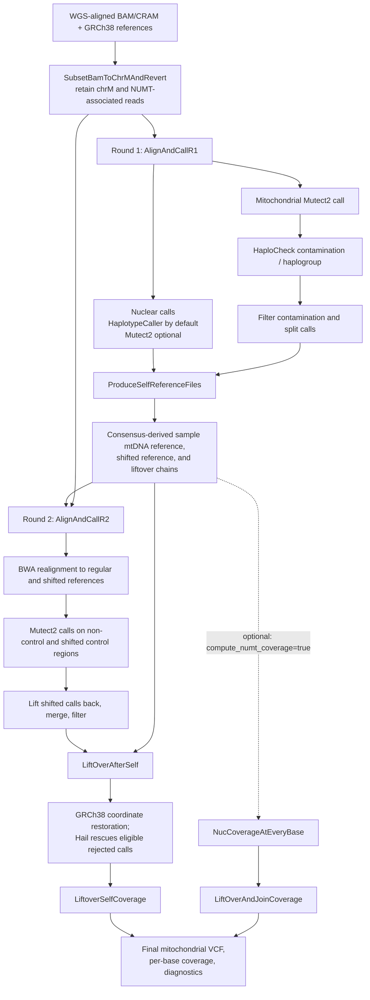

# mtSwirl WDL pipeline

[](https://zenodo.org/badge/latestdoi/448948131)


The original mtSwirl project developed reference-aware quantification of mtDNA
copy number and heteroplasmy from whole-genome sequencing (WGS) data. The
source repository includes single-sample and multi-sample WDL workflows.

For work using the pipeline, cite the associated paper:

> Gupta, R., Kanai, M., Durham, T.J. et al. Nuclear genetic control of mtDNA
> copy number and heteroplasmy in humans. *Nature* (2023).
> https://doi.org/10.1038/s41586-023-06426-5


The original source includes two main workflow versions:
- **Single-sample v2.5:** WDL workflow for processing one WGS CRAM/BAM
  and producing mitochondrial calls and QC outputs.
- **Multi-sample v2.6:** serial and parallel WDL workflows for batched
  multi-sample processing (e.g., UKB and AoU).

The original workflows rely on several Docker images (up to five, depending on
the workflow).

## This repository

This repository currently provides a host-based adaptation of the mtSwirl
workflow, with `SwirlPipeline` as its default entry point for one or more
samples. Cromwell orchestrates the workflow; bioinformatics and scripting
tools are supplied by local Conda environments or HPC modules. The per-sample
workflow is an internal subworkflow, not the user-facing entry point. The
active workflow does not run in a consolidated container; container packaging
remains planned work.


## Repository layout

```text
inputs/
├── config/                       # Local Cromwell configuration
├── json/                         # SwirlPipeline config and shared inputs
├── wdl/                          # SwirlPipeline and its subworkflow/task WDLs
├── test/                         # Local test inputs (chrM/NUMT reads)
└── wgs/                          # Full-wgs sample inputs (offline tests)
resources/
├── files/                        # chrM and NUMT resources
├── grch38/                       # GRCh38 reference files (offline tests)
├── jar/                          # HaploCheck JAR, Cromwell and Womtools (offline tests)
└── scripts/                      # Bash, Python, and R helpers
outputs/
├── cromwell-executions/              # Execution workspaces and intermediates (offline)
├── cromwell-workflow-logs/           # Cromwell workflow logs (offline)
└── cromwell-outputs/                 # Curated outputs after successful runs (offline)
```

## Per-sample workflow

`SwirlPipeline` in `inputs/wdl/SwirlPipeline.wdl` is the default entry point.
It scatters the per-sample workflow over rows in a sample manifest, then merges
the per-sample statistics, coverage, and variant calls. Each sample starts
with a WGS-aligned BAM/CRAM, calls variants against the original reference,
builds a sample-specific mitochondrial reference from high-confidence
homoplasmies, then realigns and calls variants again against that reference.
The final calls and coverage are returned to GRCh38 coordinates. The two
calling rounds help reduce reference-allele bias; the second alignment also
handles the circular mitochondrial control region by calling it in a shifted
coordinate system.



### What each WDL task does

The following names are the task identifiers in `inputs/wdl/MongoTasks.wdl`;
the round and reference-generation workflows call them in the order shown
above. Some tasks are conditional or are alternatives.

| Stage | Task | Purpose |
|---|---|---|
| Input preparation | `MongoSubsetBamToChrMAndRevert` | Select reads overlapping chrM and supplied nuclear mitochondrial insertion (NUMT) intervals; prepare the subset BAM and an unmapped-read BAM for later realignment. Also records alignment and coverage QC. |
| Round 1, nuclear | `MongoHC` | Calls nuclear variants with GATK HaplotypeCaller (the default path) and produces filtered and split VCFs. |
| Round 1, nuclear alternative | `MongoNucM2` | Alternative nuclear Mutect2 calling/filtering path when HaplotypeCaller is disabled. |
| Round 1, mitochondria | `MongoRunM2InitialFilterSplit` | Runs mitochondrial Mutect2 and initial filtering/statistics; provides calls for contamination estimation. |
| Round 1, QC | `GetContamination` | Runs the local HaploCheck CLI on mitochondrial calls to estimate contamination and report major/minor haplogroups. |
| Round 1, filtering | `MongoM2FilterContaminationSplit` | Applies contamination-aware mitochondrial filtering and emits split calls used downstream. |
| Personalized reference | `MongoProduceSelfReference` | Applies selected homoplasmies to create sample-specific mitochondrial FASTA references (regular and shifted), indexes/dictionaries, liftover chains, and downstream calls/intervals. Checks overlapping or out-of-interval variants. |
| Personalized reference | `MongoChainSwapLiftoverBed` | Reverses the reference-to-self chain as needed and lifts blacklist BED annotations into sample-reference coordinates. |
| Personalized reference, optional | `CreateSpanIntervalsWithDict` | Rebuilds nuclear interval lists to span contigs in the personalized-reference dictionary; used for NUMT coverage. |
| Personalized reference, optional | `ChainSwap` | Reverses a chain file for the nuclear self-reference liftover direction; used for NUMT coverage. |
| Personalized reference, optional | `MoveChainToZero` | Adjusts nuclear chain coordinates to the zero-based contigs produced from interval subsets; used for NUMT coverage. |
| Round 2, alignment/QC | `MongoAlignToMtRegShiftedAndMetrics` | Converts subset reads to FASTQ, aligns separately with BWA to regular and shifted references, merges/sorts with GATK, marks duplicates, and collects alignment/coverage metrics. |
| Round 2, calling | `MongoCallMtAndShifted` | Calls the non-control region against the regular reference and the control region against the shifted reference, using round-1 homoplasmies as force-call sites. |
| Round 2, filtering | `MongoLiftoverCombineMergeFilterContamSplit` | Returns shifted control-region calls to regular self-reference coordinates, combines the calls, applies filtering, and produces split VCFs. |
| Final calls/coverage | `MongoLiftoverVCFAndGetCoverage` | Lifts second-round calls back to GRCh38; uses Hail to rescue eligible liftover rejects, merges rescued and successful calls, and calculates per-base mitochondrial coverage. |
| Final calls/coverage | `MongoLiftoverSelfAndCollectOutputs` | Lifts coverage back to reference coordinates, accounts for homoplasmic deletion coverage, and assembles the diagnostic statistics table. |
| NUMT coverage, optional | `NucCoverageAtEveryBase` | Measures per-base nuclear/NUMT interval coverage before and after realignment to regular and shifted personalized references. |
| NUMT coverage, optional | `LiftOverAndJoinCoverage` | Maps personalized-reference coverage back to the original intervals and joins the tables for comparison. |

## Requirements

To run `SwirlPipeline` locally without Docker or Apptainer, prepare the input
data and reference files, then make the required tools available on `PATH`
(for example, using Conda environments or HPC modules). Preparing the inputs
may require internet access or transferring files from an environment with
data access.

Required tools and data include:

- Reference FASTA, index, and sequence dictionary (tested with GATK GRCH38 bundle).
- One or more BAM/CRAM files and their matching indexes (two test files included).
- Java 17 (for Cromwell, Womtools, GATK, and HaploChecker).
- Python (tested with 3.12).
- R (tested with R 4.5.3); also `Rscript` and `data.table`.
- Cromwell and Womtool (tested with v92).
- GATK (tested with 4.7); requires Java 17.
- BWA (tested with 0.7.19).
- BEDtools (tested with v2.31).
- HTSlib suite (tested with v1.24).
- IGV tools (tested with v2.17).
- UCSC lift-over and chain-swap tools (tested with v502).
- Hail with Python 3.11 and Java 11 is recommended for the current Hail release.
- Sufficient disk space for references, input data, and workflow intermediates.

Conda is recommended for installing and isolating dependencies. `curl` or
`wget`, `gzip`, `md5sum`, and Google Cloud CLI (`gcloud`) are useful for
downloading and checking inputs and reference files.

## Running `SwirlPipeline`

### Prepare WGS files and manifest

Provide a CSV, TSV, or semicolon-delimited manifest with a sample ID, BAM/CRAM
path, and matching index path for each row. The runner combines these rows with
the shared files (e.g., reference genome, resources, etc) and options configured
in `inputs/json/`.

The sample name must match the BAM/CRAM read group's `SM` field.


The small, pre-packaged test fixtures listed in `inputs/test/samples.tsv`
were created from these publicly available full-WGS samples using the
workflow's GATK `PrintReads` extraction: the chrM interval, all 385 intervals
in `resources/files/NUMTv3_all385.hg38.interval_list`, and the workflow's
mate-read filters. The extracted BAMs are reduced test inputs, not full-WGS
data.

- **NA18484:** [CRAM](https://ftp.sra.ebi.ac.uk/vol1/run/ERR398/ERR3989343/NA18484.final.cram),
  [CRAI](https://ftp.sra.ebi.ac.uk/vol1/run/ERR398/ERR3989343/NA18484.final.cram.crai).
- **HG00438:** [CRAM](https://human-pangenomics.s3.amazonaws.com/submissions/325b4b1c-9f20-49be-b03a-596da89c466e--1000G_CHILDREN/HG00438/1000G_data/HG00438.final.cram),
  [CRAI](https://human-pangenomics.s3.amazonaws.com/submissions/325b4b1c-9f20-49be-b03a-596da89c466e--1000G_CHILDREN/HG00438/1000G_data/HG00438.final.cram.crai).
  HG00438 is also used by MitoHPC for testing.

The full-WGS files are not included in this repository; `inputs/wgs/` is
excluded from Git.

For any full-WGS input, verify compatibility with the configured GRCh38
reference before running it through SwirlPipeline, for example by creating
dictionary (`*.dict`) files for your inputs and comparing them to the reference
dictionary.

### Prepare the reference genome

Place the reference FASTA, FAI, and dictionary in `resources/grch38/`.

It's recommended to use the GATK bundle for GRCh38.
Use `gcloud` to fetch the files from the public bucket:

```bash
# from rep root
mkdir -p resources/grch38

gcloud storage cp \
  "gs://gcp-public-data--broad-references/hg38/v0/Homo_sapiens_assembly38.fasta" \
  "gs://gcp-public-data--broad-references/hg38/v0/Homo_sapiens_assembly38.fasta.fai" \
  "gs://gcp-public-data--broad-references/hg38/v0/Homo_sapiens_assembly38.dict" \
  ./resources/grch38
```

The corresponding mitochondrial FASTA files, indices, interval lists, blacklist, and
liftover resources for GRCh38 are already provided under `resources/files/`.
These were downloaded from the same bucket:
`gs://gcp-public-data--broad-references/hg38/v0/chrM/`

No separate mitochondrial-reference download is needed unless working with a different
reference other than GRCh38.

### Prepare required tools and environment

`SwirlPipeline` expects host tools on `PATH`. Use separate
environments so Cromwell/GATK can use Java 17 while the current Hail release
uses its supported Java 11 runtime.

Create the tools environment with Python 3.12, Java 17, GATK, the
bioinformatics command-line tools, and R:

```bash
conda create -n mtSwirl-tools --strict-channel-priority \
  -c conda-forge -c bioconda \
  python=3.12 openjdk=17 gatk4-main=4.7.0.0 \
  bwa=0.7.19 samtools=1.24 bcftools=1.24 htslib=1.24 bedtools=2.31 igvtools=2.17 \
  ucsc-liftover=502 ucsc-chainswap=502 \
  r-base=4.5 r-data.table=1.18
```

Create a separate Python 3.11 / Java 11 environment for Hail:

```bash
conda create -n mtSwirl-hail --strict-channel-priority \
  -c conda-forge python=3.11 openjdk=11 pip
conda activate mtSwirl-hail
python -m pip install "hail==0.2.139"
```


The tool directories are configured in
`inputs/json/pipeline_configs.json` under `workflow.dependencies.tools_path`
and `workflow.dependencies.hail_path`; each may be either an environment
directory or its `bin` directory. The runner checks both locations, adds
available directories to `PATH`, and falls back to tools already on `PATH`.
In this setup, `mtSwirl-tools` supplies Java 17 for Cromwell and GATK, plus
`R`/`Rscript`; `mtSwirl-hail` supplies Java 11 and Python 3.11 with Hail. The
HaploCheck CLI path is configured alongside them in
`workflow.dependencies.haplocheck_cli`. Use the optional `TOOLS_PATH` and
`HAIL_PATH` environment variables to override the configured tool directories
for one run. The runner does not call `conda activate`.

The `curl`, `wget`, `gzip`, `md5sum`, and `gcloud` utilities are only needed
when downloading or checking data and references; install them separately if
they are not already available on the host.


### Cromwell and Womtool


Make sure Cromwell is available. This workflow was tested with Cromwell and Womtool v92 but other versions should work. They are stored in `resources/jar/`:

```bash
mkdir -p resources/jar
curl -fL \
  https://github.com/broadinstitute/cromwell/releases/download/92/cromwell-92.jar \
  -o resources/jar/cromwell-92.jar
curl -fL \
  https://github.com/broadinstitute/cromwell/releases/download/92/womtool-92.jar \
  -o resources/jar/womtool-92.jar
```


The `SwirlPipeline` runner uses Womtool to validate the generated inputs
automatically before it submits the workflow.

The local Cromwell config at `inputs/config/cromwell-local-single.conf`
limits execution to one task at a time. The local backend does not enforce
cloud-style WDL resource requests, so local success does not establish HPC
scheduler resource requirements.

### Run the pipeline

Run the runner from the repository root. Start with validation; this checks
the manifest, referenced files, generated inputs, and WDL without submitting
to Cromwell:

```bash
bash run_swirl_pipeline.sh --sample-manifest inputs/test/samples.tsv --validate-only
```

After validation succeeds, submit the workflow:

```bash
bash run_swirl_pipeline.sh --sample-manifest inputs/test/samples.tsv
```

To run only one sample, copy the manifest under `inputs/test/` and remove the
other sample's row.

### Runner configuration and behavior

`run_swirl_pipeline.sh` accepts a CSV, TSV, or TXT manifest via the explicit
`--sample-manifest FILE` option. Use `--test-run` instead to select the
bundled test manifest. By default, the runner reads workflow settings and paths from
`inputs/json/pipeline_configs.json`, which points to the packaged
`inputs/json/pipeline_files.json` and `inputs/json/pipeline_scripts.json`.
Edit those files in place to customize the default run; no JSON flags are
needed. The config separates runner tools, the WDL and input JSONs,
dependencies, and workflow options.

The delimiter is detected from the file contents (comma, tab, or semicolon).
Column names are case-insensitive; common variants such as `sample_name`,
`cram_path`, `bam_file`, and `idx_path` are accepted. Relative data paths are
resolved relative to the manifest's directory first, then the repository root.
Sample IDs must be unique and must match the sample name in each BAM/CRAM
read group's `SM` field.

Workflow input keys in the files and scripts JSONs may use
`MitochondriaPipeline.*`, legacy `MitochondriaPipelineWrapper.*`, or
`SwirlPipeline.*`; the runner maps them to the `SwirlPipeline` workflow
inputs. Helper-script paths use the `SwirlPipeline.prepare_script` and
`SwirlPipeline.stage_script` keys in the scripts JSON. Paths in those JSONs
are resolved relative to the repository root and must exist. Matching
workflow-input keys can occur in both JSONs, but conflicting values are
rejected. If you want to use alternate JSON files rather than edit the
packaged defaults, provide only the corresponding override flags:
`--configs-json`, `--files-json`, and/or `--scripts-json`. Set
`workflow.dependencies.haplocheck_cli` to a different local JAR path to use a
custom HaploCheck build. The `TOOLS_PATH` and `HAIL_PATH` environment
variables can override the corresponding paths in `pipeline_configs.json`.
Each configured directory is checked directly and for a `bin/` subdirectory;
required executables can also be found on the existing `PATH`.

Use `--test-run` to select the bundled two-sample manifest automatically. The
runner validates the manifest, referenced files, generated WDL inputs, and WDL
before submitting the workflow to Cromwell:

```bash
bash run_swirl_pipeline.sh --test-run
```

To validate the bundled test inputs without starting Cromwell:

```bash
bash run_swirl_pipeline.sh --test-run --validate-only
```

`--test-run` uses the packaged small fixtures, not full-WGS data. To use a
different sample set, specify its manifest with `--sample-manifest`. Optional
JSON overrides remain available if you need custom configuration:

```bash
bash run_swirl_pipeline.sh \
  --sample-manifest inputs/test/samples.tsv \
  --files-json /path/to/custom_pipeline_files.json \
  --validate-only
```

`SwirlPipeline.wdl` scatters the internal per-sample workflow across manifest
rows, then merges per-sample VCFs, coverage tables, and statistics. Curated
merged outputs and per-sample final VCF/coverage/statistics files are copied
beneath `cromwell-outputs/<workflow-id>/`.
New Cromwell execution directories use the declared workflow name and will be
under `cromwell-executions/SwirlPipeline/<workflow-id>/`; existing runs under
the old workflow name are unchanged.
The current local Cromwell config limits execution to one task at a time, so
the scatter runs sequentially unless that config is changed.


### Outputs and cleanup

Cromwell assigns a unique workflow ID to each run.

Workflow logs are under `cromwell-workflow-logs/`.

Execution data and intermediates are retained beneath
`cromwell-executions/SwirlPipeline/<workflow-id>/`.

On success, the runner stages merged VCF/coverage/statistics and per-sample
final VCF/coverage/statistics files under
`cromwell-outputs/<workflow-id>/`. Original outputs and intermediates remain
in the execution tree.

Execution directories can be large. Remove a run's directory only after
confirming that it succeeded and preserving any intermediates or outputs you
need. Curated output copies are kept separately from the execution tree.


## Project checklist

### In progress

- [ ] Run the current `SwirlPipeline` WDL successfully and preserve its
  outputs and logs as a reproducible baseline.
- [ ] Build and validate the documented `mtSwirl-tools` and `mtSwirl-hail` Conda environments on a clean setup.
- [ ] Update the online documentation with the tested workflow.
- [ ] Package the tested `SwirlPipeline` workflow in Docker/Apptainer.
- [ ] Run `SwirlPipeline` using Docker/Apptainer.
- [ ] Update the documentation adding a containerized version.


### Low priority

- [ ] Consolidate R and shell helper logic into Python scripts, porting one
  operation at a time and comparing outputs against the baseline.
- [ ] Add focused tests for the Python helpers, including representative
  edge cases from the existing workflow.
- [ ] Harmonize WDL memory assignments across tasks: use consistent task
  runtime memory and Java heap conventions, and verify that Java heap limits
  leave sufficient headroom within each task's total memory allocation.
- [ ] Run the complete workflow on the target HPC system and compare final
  and relevant intermediate outputs against the baseline.
- [ ] Measure actual CPU, memory, disk, and runtime requirements on the
  target HPC environment; the local Cromwell backend does not validate
  scheduler resource requests.
- [ ] Develop and validate the separate cross-sample merging workflow.


# Legacy and archived content

The former standalone NA18484 single-sample input JSONs are in
`archive/json/` and are retained only for reference; the documented entry
point is `SwirlPipeline`.

## Multi-sample workflows and DNAnexus

The repository's multi-sample v2.6 WDLs and their example DNAnexus input
templates have been moved under `archive/` and are ignored by Git. They are
available only in working copies where those files are present; they will not
be included in a fresh clone. The local archived entry workflows are:

- Serial: `archive/wdl/fullMitoPipeline_v2_6_Multi.wdl`
- Parallel: `archive/wdl/parallel_fullMitoPipeline_v2_6_Multi.wdl`

If you have those files locally and use DNAnexus, compile from the repository
root with dxCompiler:

```bash
bash archive/scripts/run-dxcompiler-docker-multi compile \
  archive/wdl/fullMitoPipeline_v2_6_Multi.wdl \
  -project PROJECT_ID -folder DESIRED_DX_PATH -f
```

For the parallel workflow:

```bash
bash archive/scripts/run-dxcompiler-docker-multi compile \
  archive/wdl/parallel_fullMitoPipeline_v2_6_Multi.wdl \
  -project PROJECT_ID -folder DESIRED_DX_PATH -f
```

The archived input templates are `archive/json/prepopulated_inputs_dx.json`
and `archive/json/prepopulated_inputs_dx_parallel.json`. They are examples
only: replace Docker image placeholders, update file locations to DNAnexus
links, and supply three per-run arrays with matching order and length:

- `stage-common.sample_name`: sample names.
- `stage-common.wgs_aligned_input_bam_or_cram`: WGS CRAM/BAM links.
- `stage-common.wgs_aligned_input_bam_or_cram_index`: matching CRAI/BAI links.

The parallel template shows the higher CPU and batch-size settings expected
for the parallel workflow. The WDL documentation recommends batching up to
18 samples for the serial full pipeline or 40 for the parallel workflow,
subject to available instance resources.

### Multi-sample image inputs

The archived multi-sample WDLs may refer to these image inputs:

- `ucsc_docker`: `rahulg603/ucsc_docker`
- `genomes_cloud_docker`: `rahulg603/genomes_cloud_docker`
- `haplochecker_docker`: `rahulg603/haplochecker_docker`
- `gatk_samtools_docker`: `rahulg603/gatk_samtools_docker`

These archived workflows are not used by the active local `SwirlPipeline` run.
