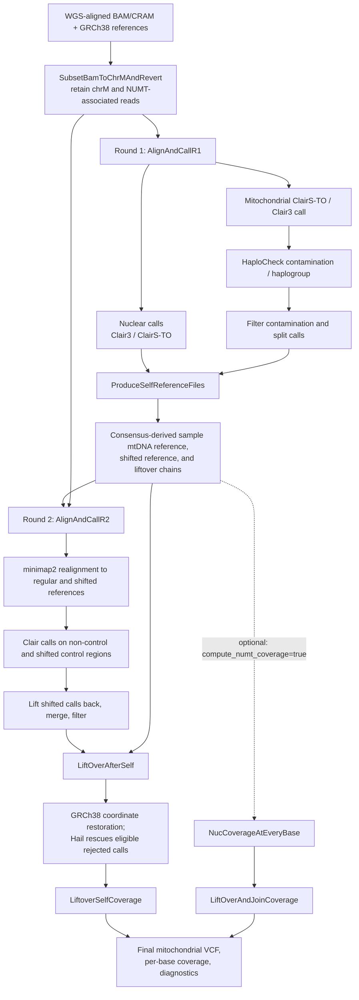

# mtSwirl WDL pipeline

[](https://zenodo.org/badge/latestdoi/448948131)


This repository was built from the original mtSwirl **single-sample v2.5**
workflow, which developed reference-aware quantification of mtDNA copy number
and heteroplasmy from whole-genome sequencing (WGS) data.

For work using the pipeline, cite the associated paper:

> Gupta, R., Kanai, M., Durham, T.J. et al. Nuclear genetic control of mtDNA
> copy number and heteroplasmy in humans. *Nature* (2023).
> https://doi.org/10.1038/s41586-023-06426-5


## This repository

It provides a host-based adaptation of that workflow, with `SwirlPipeline` as
its default entry point for one or more samples. Cromwell orchestrates the
workflow; bioinformatics and scripting tools are supplied by local Conda
environments or HPC modules. The per-sample workflow is an internal
subworkflow, not the user-facing entry point. Docker and Apptainer packaging
are provided in `docker/` (see the container sections below).


## Repository layout

```text
inputs/
├── json/                         # SwirlPipeline config and shared inputs
├── wdl/                          # SwirlPipeline and its subworkflow/task WDLs
├── test/                         # Local test inputs (chrM/NUMT reads)
└── wgs/                          # Full-wgs sample inputs (offline tests)
resources/
├── files/                        # chrM and NUMT resources
├── grch38/                       # GRCh38 reference files (offline tests)
├── jar/                          # HaploCheck JAR
└── scripts/                      # Bash, Python, and R helpers
outputs/
├── cromwell-executions/              # Execution workspaces and intermediates (offline)
├── cromwell-logs/                    # Cromwell workflow logs
└── cromwell-outputs/                 # Curated outputs after successful runs (offline)
```

## Per-sample workflow

`SwirlPipeline` in `inputs/wdl/SwirlPipeline.wdl` is the default entry point.
It scatters the per-sample workflow over rows in a sample manifest, then merges
the per-sample statistics, coverage, and variant calls. Each sample starts
with a WGS-aligned BAM/CRAM, calls variants against the original reference,
builds a sample-specific mitochondrial reference from high-confidence
homoplasmies, then realigns and calls variants again against that reference.
The final calls and coverage are returned to GRCh38 coordinates. The two
calling rounds help reduce reference-allele bias; the second alignment also
handles the circular mitochondrial control region by calling it in a shifted
coordinate system.



### What each WDL task does

The following names are the task identifiers in `inputs/wdl/MongoTasks.wdl`;
the round and reference-generation workflows call them in the order shown
above. Some tasks are conditional or are alternatives.

| Stage | Task | Purpose |
|---|---|---|
| Input preparation | `MongoSubsetBamToChrMAndRevert` | Select reads overlapping chrM and supplied nuclear mitochondrial insertion (NUMT) intervals; prepare the subset BAM and an unmapped-read BAM for later realignment. Also records alignment and coverage QC. |
| Round 1, nuclear | `MongoHC` | Calls nuclear variants with GATK HaplotypeCaller (the default path) and produces filtered and split VCFs. |
| Round 1, nuclear alternative | `MongoNucM2` | Alternative nuclear Mutect2 calling/filtering path when HaplotypeCaller is disabled. |
| Round 1, mitochondria | `MongoRunM2InitialFilterSplit` | Runs mitochondrial Mutect2 and initial filtering/statistics; provides calls for contamination estimation. |
| Round 1, QC | `GetContamination` | Runs the local HaploCheck CLI on mitochondrial calls to estimate contamination and report major/minor haplogroups. |
| Round 1, filtering | `MongoM2FilterContaminationSplit` | Applies contamination-aware mitochondrial filtering and emits split calls used downstream. |
| Personalized reference | `MongoProduceSelfReference` | Applies selected homoplasmies to create sample-specific mitochondrial FASTA references (regular and shifted), indexes/dictionaries, liftover chains, and downstream calls/intervals. Checks overlapping or out-of-interval variants. |
| Personalized reference | `MongoChainSwapLiftoverBed` | Reverses the reference-to-self chain as needed and lifts blacklist BED annotations into sample-reference coordinates. |
| Personalized reference, optional | `CreateSpanIntervalsWithDict` | Rebuilds nuclear interval lists to span contigs in the personalized-reference dictionary; used for NUMT coverage. |
| Personalized reference, optional | `ChainSwap` | Reverses a chain file for the nuclear self-reference liftover direction; used for NUMT coverage. |
| Personalized reference, optional | `MoveChainToZero` | Adjusts nuclear chain coordinates to the zero-based contigs produced from interval subsets; used for NUMT coverage. |
| Round 2, alignment/QC | `MongoAlignToMtRegShiftedAndMetrics` | Converts subset reads to FASTQ, aligns separately with BWA to regular and shifted references, merges/sorts with GATK, marks duplicates, and collects alignment/coverage metrics. |
| Round 2, calling | `MongoCallMtAndShifted` | Calls the non-control region against the regular reference and the control region against the shifted reference, using round-1 homoplasmies as force-call sites. |
| Round 2, filtering | `MongoLiftoverCombineMergeFilterContamSplit` | Returns shifted control-region calls to regular self-reference coordinates, combines the calls, applies filtering, and produces split VCFs. |
| Final calls/coverage | `MongoLiftoverVCFAndGetCoverage` | Lifts second-round calls back to GRCh38; uses Hail to rescue eligible liftover rejects, merges rescued and successful calls, and calculates per-base mitochondrial coverage. |
| Final calls/coverage | `MongoLiftoverSelfAndCollectOutputs` | Lifts coverage back to reference coordinates, accounts for homoplasmic deletion coverage, and assembles the diagnostic statistics table. |
| NUMT coverage, optional | `NucCoverageAtEveryBase` | Measures per-base nuclear/NUMT interval coverage before and after realignment to regular and shifted personalized references. |
| NUMT coverage, optional | `LiftOverAndJoinCoverage` | Maps personalized-reference coverage back to the original intervals and joins the tables for comparison. |


## `monticamb` ONT long-read variant

This variant adapts the pipeline to Oxford Nanopore reads while keeping the two-round,
self-reference layout. It builds on `mitocamb`; the task names are unchanged.

| Short-read step | Long-read replacement |
| --- | --- |
| GATK PrintReads + mate rescue + MarkDuplicates | `samtools view` (primary alignments, mt + NUMT regions), aligned-length/fraction read filter, optional read cap; no mate rescue or duplicate marking |
| BWA + MergeBamAlignment | `minimap2 -ax map-ont -Y --secondary=no -y` (MM/ML base-modification tags kept) |
| HaplotypeCaller / Mutect2 / FilterMutectCalls | one shared script, `resources/scripts/sh/call_variants_ont.sh`, running ClairS-TO (default) or Clair3 (`mt_caller`) |

Defaults (`inputs/json/pipeline_configs.json`): `vaf_filter_threshold` 0.005 (kept low for
benchmarking), `min_aligned_length` 6000 and `min_aligned_fraction` 0.95 (reads must be mostly
aligned and longer than the longest NUMT, as in MitoHPC2 `filter.lr.sh`), `max_reads` 4000
(random cap, roughly bounding depth), `clairs_platform` `ont_r10_dorado_sup_5khz`,
`clair3_model` `r1041_e82_400bps_sup_v520`, and `tier_thresholds` `0.03,0.05,0.10`, which writes
extra `*.tierNN.vcf` files from the round-2 final split VCF (the `tier_vcfs` task output of
`AlignAndCallR2`).

Post-processing in `call_variants_ont.sh`: soft filters `LowAF`, `LowDP`, `Homopolymer`
(indels inside runs of at least 4 identical bases with AF below 0.5, as in MitoHPC2) and
`blacklisted_site`; multi-allelics are split and the AF floor is re-applied per ALT allele.

Limitations: Clair has no contamination model (haplocheck output is reported only);
ClairS-TO is a somatic caller, so recall of near-homoplasmic variants (which seed the self
reference) must be benchmarked against `mt_caller: clair3`; reads whose primary alignment lies
outside chrM/NUMT regions are not extracted; Conda packages are unpinned; only smoke tests with
synthetic reads and stub callers have been run.

## TL;DR

1. Clone the repository:

   ```bash
   git clone https://github.com/mahmoudkoko/mtSwirl.git
   cd mtSwirl
   ```

2. Create the Conda environment (tools, Cromwell, Womtool, R, Java 17) and
   install Hail:

   ```bash
   conda create -n mtSwirl-tools --strict-channel-priority \
     -c conda-forge -c bioconda \
     python=3.12 openjdk=17 gatk4-main=4.7.0.0 cromwell=92 \
     htslib=1.24 samtools=1.24 bcftools=1.24 \
     minimap2 clair3 clairs-to bedtools=2.31 igvtools=2.17 \
     ucsc-liftover=502 ucsc-chainswap=502 \
     r-base=4.5 r-data.table=1.18
   conda run -n mtSwirl-tools python -m pip install "hail==0.2.139"
   ```

   The runner finds the environment through `workflow.dependencies.tools_path`
   in `inputs/json/pipeline_configs.json` (default
   `$CONDA_PREFIX/envs/mtSwirl-tools`), or through `TOOLS_PATH`.

3. Provide the GRCh38 reference (FASTA, `.fai`, `.dict`; about 3 GB) in
   `resources/grch38/`. Use one of the following:

   ```bash
   mkdir -p resources/grch38
   base=https://storage.googleapis.com/gcp-public-data--broad-references/hg38/v0

   # a) Download with curl
   for f in Homo_sapiens_assembly38.fasta Homo_sapiens_assembly38.fasta.fai Homo_sapiens_assembly38.dict; do
     curl -L -C - -o "resources/grch38/$f" "$base/$f"
   done
   #    ...or with wget: wget -c -P resources/grch38 "$base/$f"
   #    ...or with gcloud: gcloud storage cp "gs://gcp-public-data--broad-references/hg38/v0/$f" resources/grch38/

   # b) Already have a copy? Symlink it (no extra disk space)
   ref=/path/to/your/reference_dir
   for f in Homo_sapiens_assembly38.fasta Homo_sapiens_assembly38.fasta.fai Homo_sapiens_assembly38.dict; do
     ln -s "$ref/$f" "resources/grch38/$f"
   done

   # c) Or copy it
   cp "$ref"/Homo_sapiens_assembly38.{fasta,fasta.fai,dict} resources/grch38/
   ```

   Symlinks are fine for local runs. For Docker, mount the real directory
   (or copy the files), since symlinks pointing outside the mount will break.

4. Validate the setup (checks tools, inputs, and the WDL with Womtool, without
   running Cromwell):

   ```bash
   ./run_swirl_pipeline.sh --test-run --validate-only
   ```

   Then run the bundled one-sample test (HG00438):

   ```bash
   ./run_swirl_pipeline.sh --test-run
   ```

   Results are staged under `outputs/cromwell-outputs/SwirlPipeline/<workflow-id>/`.
   A per-stage timing summary is printed at the end. To smoke-check the staged
   outputs (files present, VCF record counts):

   ```bash
   python3 resources/scripts/py/check_outputs.py outputs/cromwell-outputs/SwirlPipeline/<workflow-id>
   ```

5. Run your own samples with a manifest (`sample_id,bam_path,index_path`):

   ```bash
   ./run_swirl_pipeline.sh --sample-manifest /path/to/samples.csv
   ```

   To use Docker instead of Conda, see "Run with Docker" below.

## Requirements

To run `SwirlPipeline` locally without Docker or Apptainer, prepare the input
data and reference files, then make the required tools available on `PATH`
(for example, using Conda environments or HPC modules). Preparing the inputs
may require internet access or transferring files from an environment with
data access.


Conda is recommended for installing and isolating dependencies (tested with v26.9.4)

Required tools include:

- Java 17 (for Cromwell, Womtools, GATK, and HaploChecker).
- Python (tested with 3.12).
- R (tested with R 4.5.3); also `Rscript` and `data.table`.
- Cromwell and Womtool (tested with v92).
- GATK (tested with 4.7); requires Java 17.
- minimap2, Clair3 and ClairS-TO (monticamb; versions not yet pinned or benchmarked).
- BEDtools (tested with v2.31).
- HTSlib suite (tested with v1.24).
- IGV tools (tested with v2.17).
- UCSC lift-over and chain-swap tools (tested with v502).
- Hail (tested with 0.2.139; works with Java 17).

Required data include:

- Reference FASTA, index, and sequence dictionary (tested with GATK GRCH38 bundle).
- One or more BAM/CRAM files and their matching indexes (two test files included).
- Sufficient disk space for references, input data, and workflow intermediates.

`curl` or `wget`, `gzip`, `md5sum`, and Google Cloud CLI (`gcloud`) are useful for
downloading and checking inputs and reference files.

## Running `SwirlPipeline`

### Prepare WGS files and manifest

Provide a CSV, TSV, or semicolon-delimited manifest with a sample ID, BAM/CRAM
path, and matching index path for each row. The runner combines these rows with
the shared files (e.g., reference genome, resources, etc) and options configured
in `inputs/json/`.

The sample name must match the BAM/CRAM read group's `SM` field.


The small, pre-packaged test fixtures listed in `inputs/test/two_test_samples.tsv`
were created from these publicly available full-WGS samples using the
workflow's GATK `PrintReads` extraction: the chrM interval, all 385 intervals
in `resources/files/NUMTv3_all385.hg38.interval_list`, and the workflow's
mate-read filters. The extracted BAMs are reduced test inputs, not full-WGS
data.

- **NA18484:** [CRAM](https://ftp.sra.ebi.ac.uk/vol1/run/ERR398/ERR3989343/NA18484.final.cram),
  [CRAI](https://ftp.sra.ebi.ac.uk/vol1/run/ERR398/ERR3989343/NA18484.final.cram.crai).
- **HG00438:** [CRAM](https://human-pangenomics.s3.amazonaws.com/submissions/325b4b1c-9f20-49be-b03a-596da89c466e--1000G_CHILDREN/HG00438/1000G_data/HG00438.final.cram),
  [CRAI](https://human-pangenomics.s3.amazonaws.com/submissions/325b4b1c-9f20-49be-b03a-596da89c466e--1000G_CHILDREN/HG00438/1000G_data/HG00438.final.cram.crai).
  HG00438 is also used by MitoHPC for testing.

The full-WGS files are not included in this repository; `inputs/wgs/` is
excluded from Git.

For any full-WGS input, verify compatibility with the configured GRCh38
reference before running it through SwirlPipeline, for example by creating
dictionary (`*.dict`) files for your inputs and comparing them to the reference
dictionary.

### Prepare the reference genome

Place the reference FASTA, FAI, and dictionary (`Homo_sapiens_assembly38.fasta`,
`.fasta.fai`, `.dict`) in `resources/grch38/`. The GATK bundle for GRCh38 is recommended.

```bash
# from repo root
mkdir -p resources/grch38
base=https://storage.googleapis.com/gcp-public-data--broad-references/hg38/v0
files="Homo_sapiens_assembly38.fasta Homo_sapiens_assembly38.fasta.fai Homo_sapiens_assembly38.dict"
```

Choose one option:

```bash
# Download with curl (resumable)
for f in $files; do curl -L -C - -o "resources/grch38/$f" "$base/$f"; done

# ...or wget
for f in $files; do wget -c -P resources/grch38 "$base/$f"; done

# ...or gcloud
for f in $files; do gcloud storage cp "gs://gcp-public-data--broad-references/hg38/v0/$f" resources/grch38/; done

# Existing local copy: symlink (no extra disk space)
ref=/path/to/your/reference_dir
for f in $files; do ln -s "$ref/$f" "resources/grch38/$f"; done

# ...or copy
for f in $files; do cp "$ref/$f" resources/grch38/; done
```

Symlinks work for local runs. With Docker, mount the real directory or copy the files,
because symlinks pointing outside the mount will break.

The corresponding mitochondrial FASTA files, indices, interval lists, blacklist, and
liftover resources for GRCh38 are already provided under `resources/files/`.
These were downloaded from the same bucket:
`gs://gcp-public-data--broad-references/hg38/v0/chrM/`

No separate mitochondrial-reference download is needed unless working with a different
reference other than GRCh38.

### Prepare required tools and environment

`SwirlPipeline` expects host tools on `PATH`.
Create the tools environment with Python 3.12, Java 17, Cromwell, GATK,
the bioinformatics command-line tools, and R:

```bash
conda create -n mtSwirl-tools --strict-channel-priority \
  -c conda-forge -c bioconda \
  python=3.12 openjdk=17 gatk4-main=4.7.0.0 cromwell=92 \
  htslib=1.24 samtools=1.24 bcftools=1.24 \
  minimap2 clair3 clairs-to bedtools=2.31 igvtools=2.17 \
  ucsc-liftover=502 ucsc-chainswap=502 \
  r-base=4.5 r-data.table=1.18
```

Install Hail with `pip`:

```bash
conda activate mtSwirl-tools
python -m pip install "hail==0.2.139"
conda deactivate
```


The tool directory is configured in
`inputs/json/pipeline_configs.json` under `workflow.dependencies.tools_path`;
it may be either an environment directory or its `bin` directory. The runner
adds it to `PATH` and falls back to tools already on `PATH`. The single
`mtSwirl-tools` environment supplies Java 17, GATK, `cromwell`, `womtool`,
`R`/`Rscript`, and Python with Hail. The HaploCheck CLI path is configured
alongside it in `workflow.dependencies.haplocheck_cli`. Use the optional
`TOOLS_PATH` environment variable to override the configured directory for one
run. The runner does not call `conda activate`.

The `curl`, `wget`, `gzip`, `md5sum`, and `gcloud` utilities are only needed
when downloading or checking data and references; install them separately if
they are not already available on the host.


### Cromwell and Womtool


Cromwell and Womtool (v92) are installed with the `mtSwirl-tools` Conda
environment (`cromwell=92`), which provides `cromwell` and `womtool` launchers
on `PATH`. The runner calls them directly; `-D` options such as
`-Dconfig.file=...` are passed through to the JVM.

The `SwirlPipeline` runner uses Womtool to validate the generated inputs
automatically before it submits the workflow.

The runner passes its Cromwell settings inline as `-D` options (no config
file): the local backend runs one task at a time, executions go to
`outputs/cromwell-executions`, and workflow logs to `outputs/cromwell-logs`. The local backend does not enforce
cloud-style WDL resource requests, so local success does not establish HPC
scheduler resource requirements.

### Run the pipeline

Run the runner from the repository root. Start with validation; this checks
the manifest, referenced files, generated inputs, and WDL without submitting
to Cromwell:

```bash
./run_swirl_pipeline.sh --sample-manifest inputs/test/two_test_samples.tsv --validate-only
```

After validation succeeds, submit the workflow:

```bash
./run_swirl_pipeline.sh --sample-manifest inputs/test/two_test_samples.tsv
```

A one-sample manifest, `inputs/test/one_test_sample.tsv` (HG00438 only), is
also provided. To run a different subset, copy a manifest under `inputs/test/`
and edit its rows.

### Runner configuration and behavior

`run_swirl_pipeline.sh` accepts a CSV, TSV, or TXT manifest via the explicit
`--sample-manifest FILE` option. Use `--test-run` instead to select the
bundled test manifest. By default, the runner reads workflow settings and paths from
`inputs/json/pipeline_configs.json`, which points to the packaged
`inputs/json/pipeline_files.json` and `inputs/json/pipeline_scripts.json`.
Edit those files in place to customize the default run; no JSON flags are
needed. The config separates runner tools, the WDL and input JSONs,
dependencies, and workflow options.

The delimiter is detected from the file contents (comma, tab, or semicolon).
Column names are case-insensitive; common variants such as `sample_name`,
`cram_path`, `bam_file`, and `idx_path` are accepted. Relative data paths are
resolved relative to the manifest's directory first, then the repository root.
Sample IDs must be unique and must match the sample name in each BAM/CRAM
read group's `SM` field.

Workflow input keys in the files and scripts JSONs may use
`MitochondriaPipeline.*` or `SwirlPipeline.*`; the runner maps them to the `SwirlPipeline` workflow
inputs. Helper-script paths use the `SwirlPipeline.prepare_script` and
`SwirlPipeline.stage_script` keys in the scripts JSON. Paths in those JSONs
are resolved relative to the repository root and must exist. Matching
workflow-input keys can occur in both JSONs, but conflicting values are
rejected. If you want to use alternate JSON files rather than edit the
packaged defaults, provide only the corresponding override flags:
`--configs-json`, `--files-json`, and/or `--scripts-json`. Set
`workflow.dependencies.haplocheck_cli` to a different local JAR path to use a
custom HaploCheck build. The `TOOLS_PATH` environment
variable can override the corresponding path in `pipeline_configs.json`.
The configured directory is checked directly and for a `bin/` subdirectory;
required executables can also be found on the existing `PATH`.

#### Memory settings

Task memory is set in GB per group of tasks in `workflow.options` of
`pipeline_configs.json`. Each GATK/Java task uses a heap of `mem × 1000 − 500` MB.

| Key | Tasks | Default |
|---|---|---|
| `SwirlPipeline.mem_small` | HaploCheck, self-reference, and liftover/merge filtering | 2 |
| `SwirlPipeline.mem_standard` | BAM subsetting, nuclear variant calling, contamination filtering | 4 |
| `SwirlPipeline.mem_mutect_mt` | mitochondrial Mutect2 (both rounds) | 6 |
| `SwirlPipeline.mem_align` | alignment and metrics | 6 |
| `SwirlPipeline.hail_mem` | Hail driver memory | 4 |

The Mutect2 tasks print a warning to the task's `stdout` when the sample's mean
mtDNA coverage exceeds `mem_mutect_mt × 4000` (an estimated ratio, not a
measured limit). If Mutect2 fails with an out-of-memory error on deep samples,
raise `mem_mutect_mt`. The local backend does not enforce these values as
machine limits.

Use `--test-run` to select the bundled one-sample manifest
(`inputs/test/one_test_sample.tsv`) automatically, which keeps the test short. The
runner validates the manifest, referenced files, generated WDL inputs, and WDL
before submitting the workflow to Cromwell:

```bash
./run_swirl_pipeline.sh --test-run
```

To validate the bundled test inputs without starting Cromwell:

```bash
./run_swirl_pipeline.sh --test-run --validate-only
```

`--test-run` uses the packaged small fixtures, not full-WGS data. To use a
different sample set, such as the two-sample manifest
`inputs/test/two_test_samples.tsv`, specify it with `--sample-manifest`. Optional
JSON overrides remain available if you need custom configuration:

```bash
./run_swirl_pipeline.sh \
  --sample-manifest inputs/test/two_test_samples.tsv \
  --files-json /path/to/custom_pipeline_files.json \
  --validate-only
```

The local Cromwell backend defaults to one concurrent task, as set inline by
the runner. Override that limit for a run with
`--max-concurrent-jobs N`, for example:

```bash
./run_swirl_pipeline.sh \
  --sample-manifest inputs/test/two_test_samples.tsv \
  --max-concurrent-jobs 4
```

`N` must be a positive integer. This limits concurrent Cromwell tasks, not
specifically the number of samples; task dependencies and available resources
also affect scheduling.

`SwirlPipeline.wdl` scatters the internal per-sample workflow across manifest
rows, then merges per-sample VCFs, coverage tables, and statistics. Curated
merged outputs and per-sample final VCF/coverage/statistics files are copied
beneath `cromwell-outputs/<workflow-id>/`.
New Cromwell execution directories use the declared workflow name and will be
under `cromwell-executions/SwirlPipeline/<workflow-id>/`; existing runs under
the old workflow name are unchanged.
The local Cromwell config limits execution to one task at a time by default;
use `--max-concurrent-jobs` to override the limit for an individual run.
Temporary input-processing files are created under `outputs/tmp/` and removed
when the runner exits.


### Outputs and cleanup

Cromwell assigns a unique workflow ID to each run.

Workflow logs are under `outputs/cromwell-logs/`.

Execution data and intermediates are retained beneath
`outputs/cromwell-executions/SwirlPipeline/<workflow-id>/`.

On success, the runner stages merged VCF/coverage/statistics and per-sample
final VCF/coverage/statistics files under
`outputs/cromwell-outputs/SwirlPipeline/<workflow-id>/`. Original outputs and intermediates remain
in the execution tree.

Execution directories can be large (reference files are hard-linked, so
tools that sum file sizes overstate real disk use). Pass `--cleanup-executions`
to delete the run's execution directory after Cromwell and output staging have
succeeded; failed runs are always kept for debugging. Curated output copies are
kept separately from the execution tree.

### Run with Docker

`docker/Dockerfile` builds an image with the repository, Cromwell, Womtool, and
a single tools environment (GATK, samtools, bcftools, bwa, bedtools, R, Java 17,
and Hail). The small test fixtures in `inputs/test/` are included; the GRCh38
reference and full WGS inputs are not and must be mounted. Build from the
repository root:

```bash
docker build -f docker/Dockerfile -t mtswirl:mitocamb .
```

Mount the reference read-only and a writable `outputs/` directory. The
entrypoint keeps all scratch files under `outputs/`, so the container can run
as your own user:

```bash
docker run --rm --user "$(id -u):$(id -g)" \
  -v "$PWD/resources/grch38:/opt/mtSwirl/resources/grch38:ro" \
  -v "$PWD/outputs:/opt/mtSwirl/outputs" \
  mtswirl:mitocamb --test-run
```

Arguments after the image name go to `run_swirl_pipeline.sh`. Mount any
additional inputs (for example `inputs/wgs` and a manifest) at the same paths
under `/opt/mtSwirl`. Cromwell copies the reference per task because it cannot
hard-link across mounts. The tested image completed the one-sample run in
52.8 minutes and produced 210 final VCF records.

To export or import the tested image:

```bash
docker save mtswirl:mitocamb | gzip > ~/projects/mtswirl-mitocamb.tar.gz
docker load < ~/projects/mtswirl-mitocamb.tar.gz
```

### Run with Apptainer

The Apptainer environment used for the tested build is `apptainer` with
Apptainer 1.5.4. Build the SIF from the local Docker image with a
disk-backed temporary directory; the default `/tmp` on the test WSL machine
is a 3.9 GB tmpfs and is too small for this image:

```bash
conda activate apptainer
mkdir -p ~/projects/apptainer-tmp
APPTAINER_TMPDIR=~/projects/apptainer-tmp \
TMPDIR=~/projects/apptainer-tmp \
  apptainer build ~/projects/mtswirl-mitocamb.sif \
  docker-daemon://mtswirl:mitocamb
```

Run the SIF with the same reference and output mounts:

```bash
apptainer run \
  --bind "$PWD/resources/grch38:/opt/mtSwirl/resources/grch38:ro" \
  --bind "$PWD/outputs:/opt/mtSwirl/outputs" \
  ~/projects/mtswirl-mitocamb.sif --test-run
```

If the Apptainer installation requires unprivileged user namespaces for builds,
add `--fakeroot` and ensure `newuidmap`/`newgidmap` are installed and configured.
The resulting SIF can be copied to the target machine without rebuilding it.


## Project checklist

Ordered by priority (highest first).

1. [x] Re-run the one-sample test (`./run_swirl_pipeline.sh --test-run`) with the
   current WDLs to exercise the per-task `-Xmx` settings, Hail
   `PYSPARK_SUBMIT_ARGS`, the coverage warning, and `--cleanup-executions`;
   confirm a single-sample run (including the merge step) finishes in about
   40 minutes. (Done: about 46-51 min on a 6-CPU/7.8 GB WSL machine; the
   `--cleanup-executions` option remains untested.)
2. [ ] Build and validate the documented `mtSwirl-tools` Conda environment on a clean setup.
3. [x] Run the current `SwirlPipeline` WDL successfully and preserve its
   outputs and logs as a reproducible baseline.
4. [x] Regression smoke check (`check_outputs.py`) with the baseline expectation
   of 210 HG00438 VCF records.
5. [x] Rebuild the Docker image (single environment) and run the test in the container
   (done with `mtswirl:mitocamb`: exit 0, 210 records, final VCF matches the native run).
6. [~] Build and smoke-test the Apptainer/Singularity image (completed:
   `/home/mm2724/projects/mtswirl-mitocamb.sif`, Apptainer 1.5.4, bundled tools
   verified). The full one-sample Apptainer workflow run remains pending.
7. [x] Update the repository documentation with the tested local and Docker
   workflows; Apptainer instructions are included but remain pending validation.
8. [ ] Measure peak memory per task and tune the `mem_*` groups and the
   coverage-to-memory ratio; add `runtime` memory for HPC schedulers.
9. [ ] Run the complete workflow on the target HPC system, measure actual CPU,
   memory, disk, and runtime (the local Cromwell backend does not validate
   scheduler resource requests), and compare final and relevant intermediate
   outputs against the baseline.
10. [x] Extract inline bash from the large `MongoTasks.wdl` tasks into
    `resources/scripts/sh/*.sh`, called from the WDL with `--option value` arguments (done for 11
    tasks; verified by a full one-sample run with a final VCF identical to the previous run).
    The remaining inline blocks are 30 lines or fewer (`NucCoverageAtEveryBase`,
    `MergeMultiSampleOutputs`, `MongoLiftoverCombineMergeFilterContamSplit`,
    `MongoChainSwapLiftoverBed`, `LiftOverAndJoinCoverage`, and a few two-liners).
11. [ ] Move repeated shell logic (heap setup, coverage warning, GATK call and
    filter boilerplate) into shared code, and run `shellcheck` on all extracted
    scripts (all eleven extracted so far are clean, even at style level). Cromwell
    localizes each `File` input separately, so a `common.sh` cannot be sourced
    by relative path; it would have to be baked into the image or passed in.
12. [x] After each extraction, re-run the test and compare outputs against the
    baseline before committing.
13. [x] Unit tests for the Python helpers (`python3 -m unittest discover -s tests`);
    16 tests pass for the currently covered helpers.
14. [ ] Develop and validate the separate cross-sample merging workflow.
15. [ ] Consolidate R and shell helper logic into Python scripts, porting one
    operation at a time and comparing outputs against the baseline.
16. [ ] Optional cleanup: split `MongoTasks.wdl`, shrink `fix_liftover.py`, and
    consider merging the wrapper layers.
